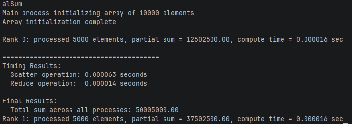
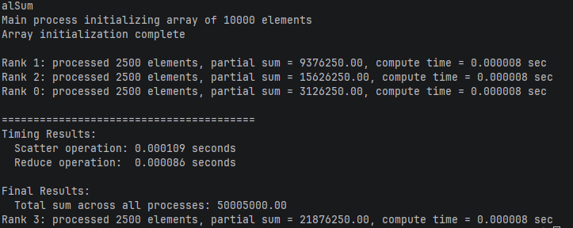
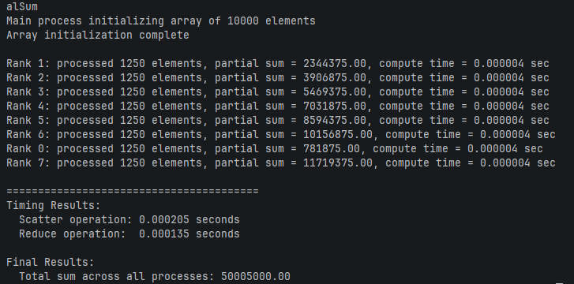

# Lab 08 - MPI Parallel Array Sum

## Task Description

The goal of this assignment is to calculate the sum of 10,000 array elements using MPI and multiple processes. The program was tested using 2, 4 and 8 processes.

## Implementation

### 1. Work Distribution

I divided the array among the processes using their rank and the total number of processes. If the array size is not evenly divisible, the remaining elements are assigned to the first processes.

### 2. MPI_Allgather

I used `MPI_Allgather` to collect each process's local array size into the `nsizes` array. This information is used to calculate the offsets needed for distributing the data.

### 3. MPI_Scatterv

`MPI_Scatterv` distributes portions of the global array from rank 0 to the local arrays. It can handle different portion sizes if the array cannot be divided equally.

### 4. Local Sum

Each process calculates the sum of its assigned elements using a loop.

### 5. MPI_Reduce

I used `MPI_Reduce` with `MPI_SUM` to combine the partial sums and store the final result on rank 0.

### 6. Memory Management

Only rank 0 frees `a_global` because it is the only process that allocates the global array. Each process frees its own `a_local` array.

## Results

| Processes | Elements per process | Total sum | Compute time, rank 0 (s) | Scatter time, rank 0 (s) | Reduce time, rank 0 (s) |
|---|---:|---:|---:|---:|---:|
| 2 | 5,000 | 50,005,000.00 | 0.000016 | 0.000063 | 0.000014 |
| 4 | 2,500 | 50,005,000.00 | 0.000008 | 0.000109 | 0.000086 |
| 8 | 1,250 | 50,005,000.00 | 0.000004 | 0.000205 | 0.000135 |

The expected sum is 10,000 × 10,001 / 2 = **50,005,000.00**, and all three runs produced this result.

## Screenshots

### 2 Processes

### 4 Processes

### 8 Processes

## My Observations

All three runs gave the correct total sum of 50,005,000.00. As I increased the number of processes, each process worked on fewer elements: 5,000 with 2 processes, 2,500 with 4 and 1,250 with 8.

The measured computation time for rank 0 decreased from 0.000016 seconds to 0.000008 seconds and then to 0.000004 seconds. However, the scatter time increased from 0.000063 seconds to 0.000205 seconds, while the reduce time increased from 0.000014 seconds to 0.000135 seconds.

This shows that dividing the work among more processes makes the local calculation shorter, but communication between processes also has a cost. Since the array contains only 10,000 elements, the communication overhead is relatively large compared to the calculation itself. These measurements are from one run and do not measure the complete program's total execution time, so they are not enough to claim an overall speedup.
