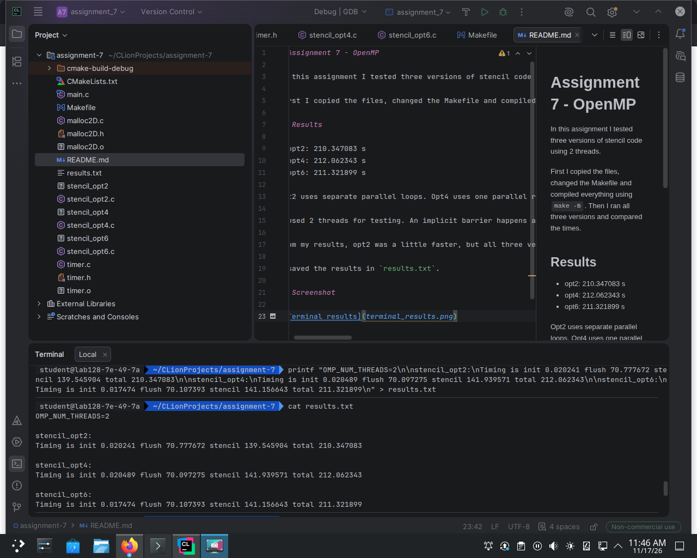

# Assignment 7 - OpenMP

In this assignment I tested three versions of stencil code using 2 threads.

First I copied the files, changed the Makefile and compiled everything using `make -B`. Then I ran all three versions and compared the times.

## Results

- opt2: 210.347083 s
- opt4: 212.062343 s
- opt6: 211.321899 s

Opt2 uses separate parallel loops. Opt4 uses one parallel region and `nowait` so threads don't have to wait every time. Opt6 divides the work between threads manually.

I used 2 threads for testing. An implicit barrier happens automatically, while an explicit barrier is added in the code with `#pragma omp barrier`. Opt2 and opt4 have implicit barriers, and opt6 has explicit barriers.

From my results, opt2 was a little faster, but all three versions had almost the same time.

I saved the results in `results.txt`.

